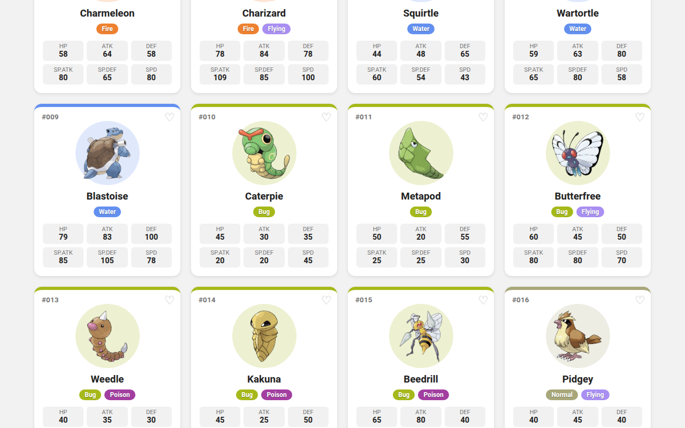
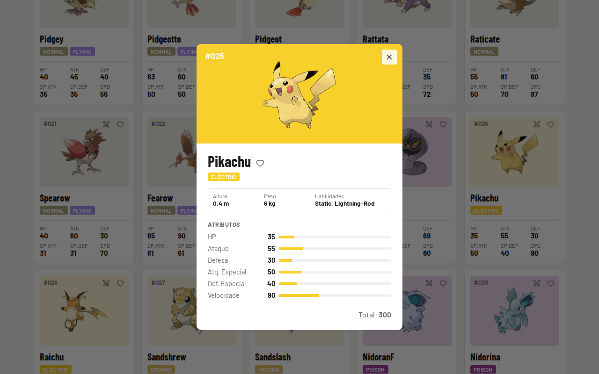
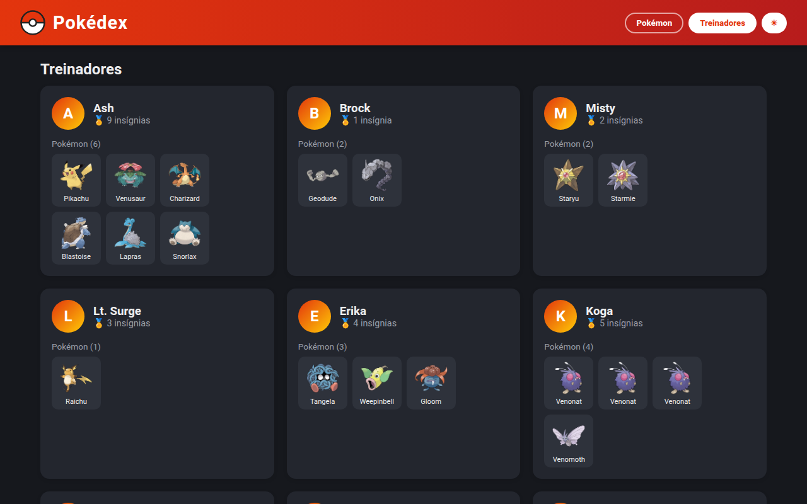

# Pokédex - React + Vite

Atividade 03 da disciplina de Desenvolvimento e Integração de Aplicações Web (DIAW).

## Dupla

- Enzo Bambirra
- Raiany Morais Ribeiro

Pokédex interativa feita com React + Vite usando os dados do arquivo `pokedex-data.json` (151 Pokémon da primeira geração e 12 treinadores).



## Funcionalidades

- Lista dos 151 Pokémon com número, nome, tipos e atributos (HP, Ataque, Defesa, Ataque Especial, Defesa Especial e Velocidade)
- Pesquisa por nome ou número (ex: `bulba`, `25`, `#025`)
- Filtro por tipo
- Modal de detalhes com barras de atributos, altura, peso e habilidades
- Página de treinadores com insígnias e seus Pokémon (clicando no Pokémon abre os detalhes)
- Ordenação por número, nome ou qualquer atributo
- Botão de Pokémon aleatório
- Favoritos (ficam salvos no navegador)
- Tema escuro
- Layout responsivo (desktop, tablet e celular)
- Mensagem quando nenhum Pokémon é encontrado
- Comparar Pokémon, mostrando qual melhor atributo entre eles através do botão ⚔️.





## Como executar

Pré-requisito: Node.js 20 ou superior.

```bash
cd atividade03
npm install
npm run dev
```

Depois é só abrir no navegador o endereço que aparece no terminal, normalmente:

```
http://localhost:5173
```

Para gerar a versão de produção:

```bash
npm run build
npm run preview
```

## Dados

Os dados ficam em `src/data/pokedex-data.json` e são importados direto no `App.jsx`. O arquivo tem três listas:

- `types`: tipos de Pokémon
- `pokemon`: Pokémon com seus atributos e tipos
- `trainers`: treinadores, quantidade de insígnias e ids dos Pokémon

Obs: o Mew (#151) vem sem tipo no json, então no app ele aparece como `Typeless`.

## API externa

As imagens e algumas informações extras vêm da [PokéAPI](https://pokeapi.co/):

- Imagens: `https://raw.githubusercontent.com/PokeAPI/sprites/master/sprites/pokemon/other/official-artwork/{id}.png`
- Altura, peso e habilidades: `https://pokeapi.co/api/v2/pokemon/{id}` (buscado quando abre o modal de detalhes)

Se a API não responder a Pokédex continua funcionando normalmente com os dados do json, só não mostra essas informações extras.

## Organização do projeto

```
atividade03/
├── docs/                    # prints usados no README
├── public/
│   └── pokeball.svg
├── src/
│   ├── components/
│   │   ├── Header.jsx           # topo com navegação e botão de tema
│   │   ├── SearchBar.jsx        # campo de pesquisa
│   │   ├── TypeFilter.jsx       # botões de filtro por tipo
│   │   ├── SortSelect.jsx       # select de ordenação
│   │   ├── PokemonList.jsx      # grid de cards
│   │   ├── PokemonCard.jsx      # card de cada Pokémon
|   |   ├── PokemonCompare.jsx   # Comparação de pokémon
│   │   ├── PokemonDetails.jsx   # modal de detalhes
│   │   ├── StatBar.jsx          # barra de atributo
│   │   ├── TypeBadge.jsx        # etiqueta colorida do tipo
│   │   ├── TrainerList.jsx      # lista de treinadores
│   │   └── TrainerCard.jsx      # card de cada treinador
│   ├── css/                     # um css para cada parte da aplicação
│   ├── data/
│   │   └── pokedex-data.json
│   ├── utils/
│   │   └── pokemon.js           # cores dos tipos, url da imagem e formatação do id
│   ├── App.jsx                  # estados principais (pesquisa, filtro, favoritos...)
│   ├── main.jsx
│   └── index.css                # estilos globais e variáveis do tema
├── index.html
├── package.json
└── vite.config.js
```

## Tecnologias

- React 19
- Vite
- CSS puro
- PokéAPI
