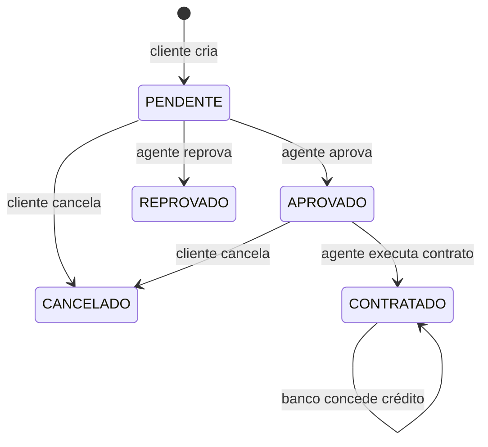
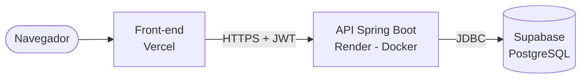
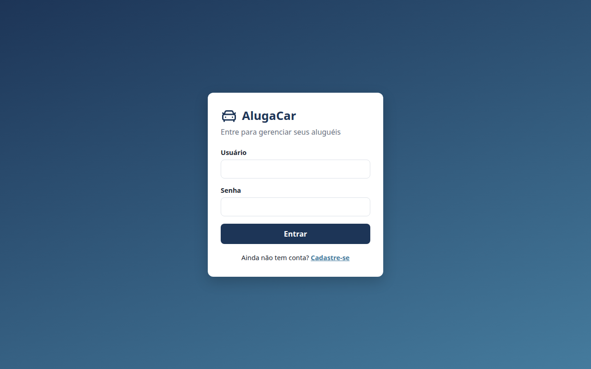
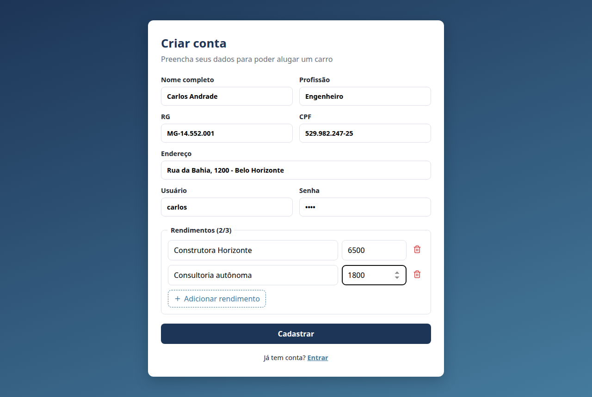
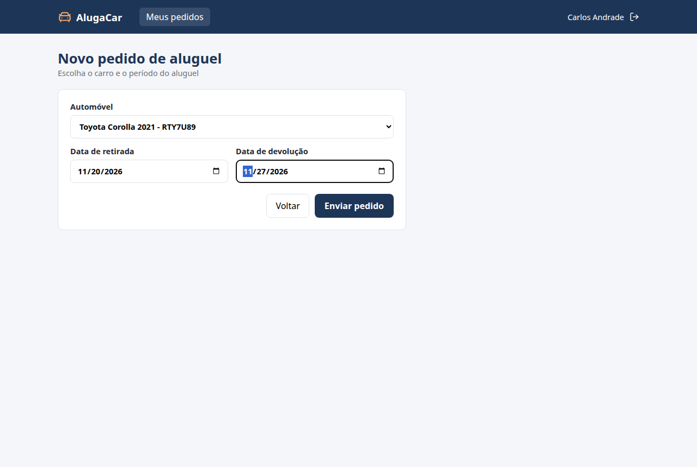
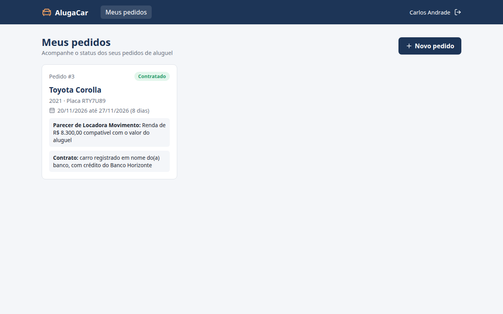
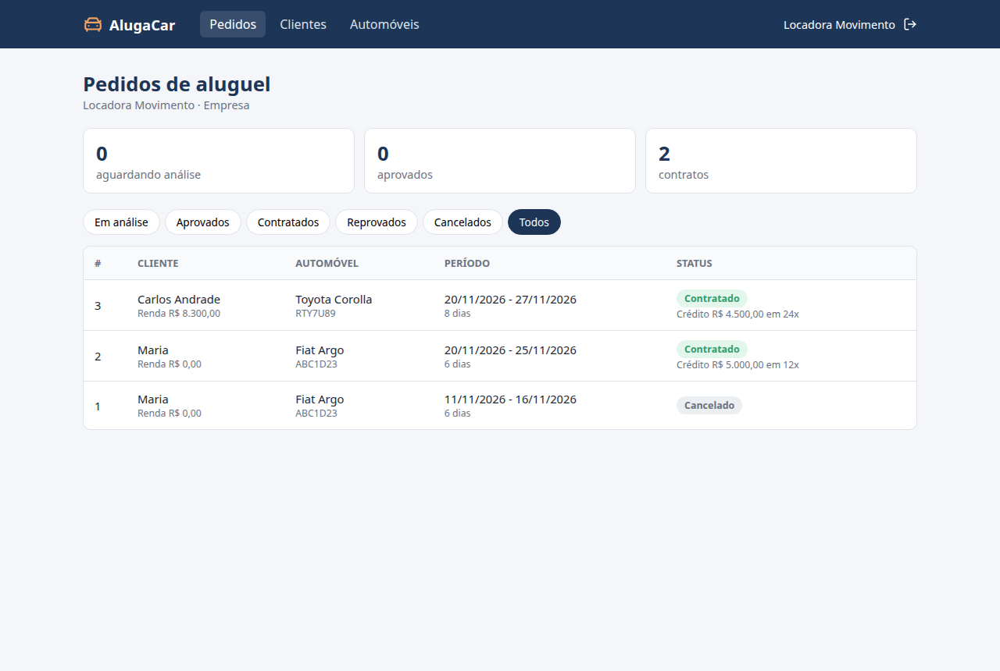
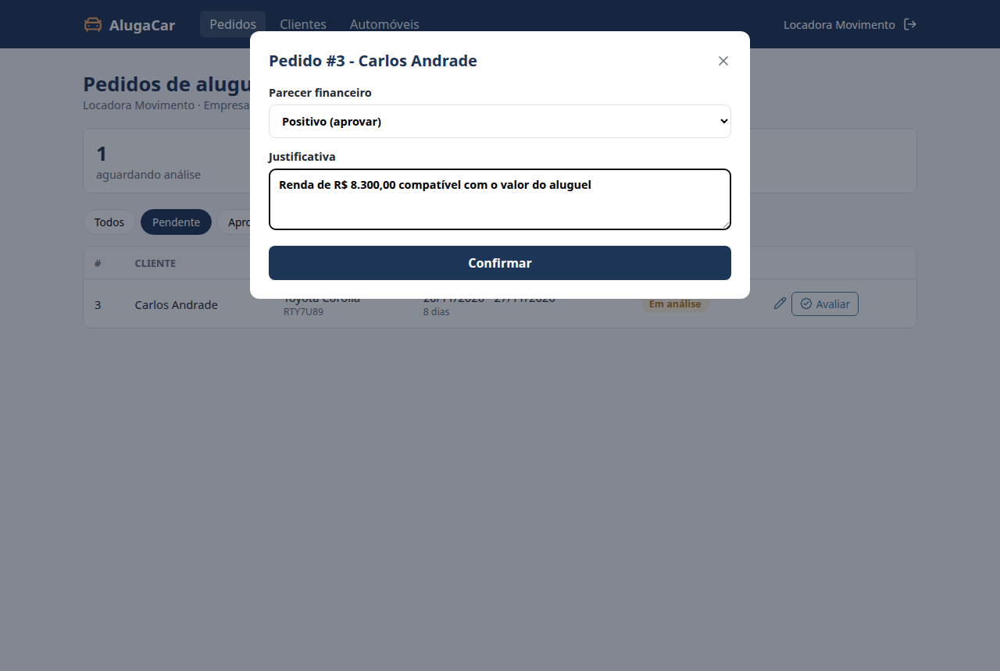
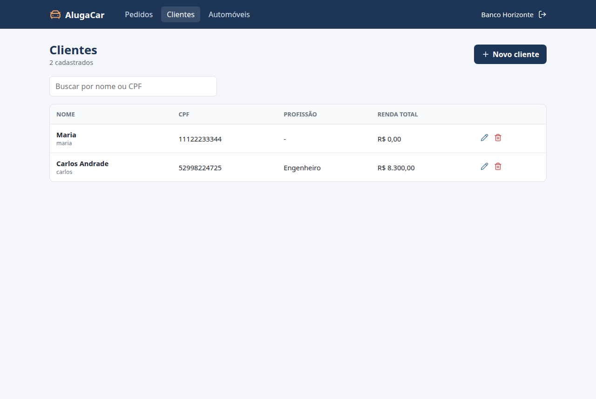
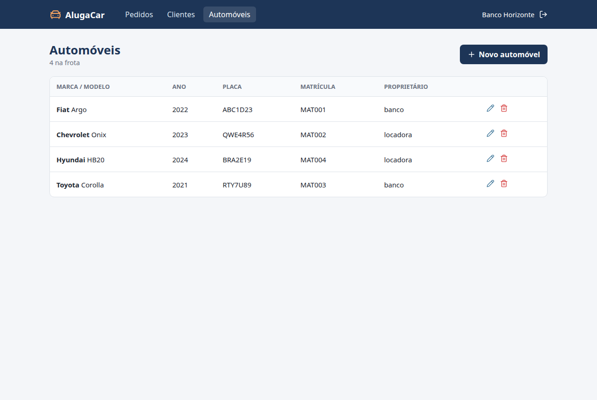

# 🚗 AlugaCar - Sistema de Aluguel de Carros

> [!NOTE]
> Sistema web para gestão de aluguéis de automóveis: clientes fazem pedidos pela internet e os agentes (empresas e bancos) analisam, aprovam e transformam os pedidos em contratos.

<table>
  <tr>
    <td width="800px">
      <div align="justify">
        Este projeto foi desenvolvido no <b>Laboratório 02</b> da disciplina de <b>Desenvolvimento e Integração de Aplicações Web (DIAW)</b> do curso de Engenharia de Software da PUC Minas. O sistema só pode ser usado depois de cadastro e login. O <i>cliente</i> cria, modifica, consulta e cancela pedidos de aluguel; os <i>agentes</i> fazem a análise financeira do pedido, executam o contrato e, no caso dos bancos, podem conceder um contrato de crédito.
      </div>
    </td>
    <td>
      <div>
        
      </div>
    </td>
  </tr>
</table>

---

## 🚧 Status do Projeto


---

## 📚 Índice
- [Links Úteis](#-links-úteis)
- [Sobre o Projeto](#-sobre-o-projeto)
- [Funcionalidades Principais](#-funcionalidades-principais)
- [Tecnologias Utilizadas](#-tecnologias-utilizadas)
- [Arquitetura](#-arquitetura)
- [Instalação e Execução](#-instalação-e-execução)
- [Deploy](#-deploy)
- [Estrutura de Pastas](#-estrutura-de-pastas)
- [Demonstração](#-demonstração)
- [Testes](#-testes)
- [Documentações utilizadas](#-documentações-utilizadas)
- [Autores](#-autores)
- [Licença](#-licença)

---

## 🔗 Links Úteis

- 🌐 **Front-end (Vercel):** _a definir após o deploy_
- ⚙️ **API (Render):** _a definir após o deploy_ (`/api/status` mostra se a API e o banco estão no ar)
- 📘 [README do Back-end](Back/README.md) · [README do Front-end](Front/README.md)
- 📐 [Diagramas UML](docs/)

---

## 📝 Sobre o Projeto

O objetivo é apoiar a gestão de aluguéis de automóveis, permitindo efetuar, cancelar e modificar pedidos pela internet.

- Sobre os **clientes** são guardados RG, CPF, nome, endereço, profissão e até **3 rendimentos** (entidade empregadora + valor).
- Sobre os **automóveis** são guardados matrícula, ano, marca, modelo e placa.
- Depois de criado, o pedido é **analisado financeiramente** por um agente. Se o parecer for positivo, o agente pode **executar o contrato**, definindo se o carro fica registrado em nome do cliente, da empresa ou do banco.
- O aluguel pode estar associado a um **contrato de crédito** concedido por um banco agente.

O sistema foi dividido nos dois subsistemas pedidos no enunciado: o **back-end**, responsável pela gestão de pedidos e contratos, e o **front-end**, responsável pela construção dinâmica das páginas web.

---

## ✨ Funcionalidades Principais

- 🔐 **Autenticação:** cadastro de cliente e login com usuário e senha (JWT). Nenhuma tela ou endpoint funciona sem login.
- 👤 **CRUD de clientes:** agentes cadastram, listam, editam e excluem clientes.
- 🚙 **Automóveis:** agentes cadastram, editam e excluem carros da frota.
- 📝 **Pedidos (cliente):** criar, modificar (enquanto está em análise), consultar o status e cancelar.
- ✅ **Avaliação (agente):** parecer financeiro positivo ou negativo, vendo a renda do cliente.
- 📄 **Contrato (agente):** transforma um pedido aprovado em contrato e define o proprietário do carro.
- 🏦 **Crédito (banco):** o banco concede um contrato de crédito (valor, juros e parcelas) para o aluguel.

### Fluxo do pedido



---

## 🛠 Tecnologias Utilizadas

### 💻 Front-end
- React 19 + Vite
- React Router
- Axios
- Lucide React (ícones)
- concurrently (sobe back e front juntos)
- CSS puro

### 🖥️ Back-end
- Java 25
- Spring Boot 4.0.9 (Web MVC, Data JPA, Security, Validation)
- JJWT (token JWT)
- Lombok
- Apache Maven

### ⚙️ Infraestrutura & DevOps
- Supabase (PostgreSQL)
- Docker (imagem do back-end)
- Render (deploy do back-end)
- Vercel (deploy do front-end)
- GitHub Actions (testes e build a cada push)

---

## 🏗 Arquitetura

O back-end segue a arquitetura **MVC**:

- **Model:** entidades JPA em `model`.
- **View:** páginas React no front-end, que consomem a API REST.
- **Controller:** classes em `controller`, que recebem as requisições e chamam os `service`, onde ficam as regras de negócio.

A autenticação é *stateless*: no login o back-end devolve um token JWT, que o front-end envia no cabeçalho `Authorization` em todas as requisições.

### Diagramas (UML)

| Diagrama | Arquivo |
|---|---|
| Casos de Uso | [docs/casos-de-uso.md](docs/casos-de-uso.md) |
| Histórias de Usuário | [docs/historias-usuario.md](docs/historias-usuario.md) |
| Classes - v1 (inicial) | [docs/diagrama-classes-v1.md](docs/diagrama-classes-v1.md) |
| Classes - v2 (atualizado) | [docs/diagrama-classes-v2.md](docs/diagrama-classes-v2.md) |
| Pacotes (visão lógica) | [docs/diagrama-pacotes.md](docs/diagrama-pacotes.md) |

As mudanças entre a v1 e a v2 do diagrama de classes estão descritas no próprio arquivo da v2.

### Endpoints da API

| Método | Rota | Quem pode |
|---|---|---|
| GET | `/` e `/api/status` | público |
| POST | `/api/auth/cadastro` | público |
| POST | `/api/auth/login` | público |
| GET | `/api/auth/me` | logado |
| GET/POST/PUT/DELETE | `/api/clientes` | agente |
| GET | `/api/automoveis` | logado |
| POST/PUT/DELETE | `/api/automoveis` | agente |
| GET | `/api/pedidos` | cliente (os seus) / agente (todos) |
| POST | `/api/pedidos` | cliente |
| PUT | `/api/pedidos/{id}` | cliente (o seu) / agente |
| PATCH | `/api/pedidos/{id}/cancelar` | cliente |
| PATCH | `/api/pedidos/{id}/avaliar` | agente |
| POST | `/api/pedidos/{id}/contrato` | agente |
| POST | `/api/pedidos/{id}/credito` | banco |

---

## 🔧 Instalação e Execução

### Pré-requisitos
- JDK 25
- Node.js 20+
- Um projeto no [Supabase](https://supabase.com/)

### 🔑 Variáveis de Ambiente

#### 1 Back-end (Spring Boot)

Copie o `Back/.env.example` para `Back/.env` e preencha com os dados do Supabase (**Connect > JDBC > Session pooler**):

```properties
DB_URL=jdbc:postgresql://aws-1-sa-east-1.pooler.supabase.com:5432/postgres
DB_USER=postgres.SEU_PROJETO
DB_PASSWORD=SUA_SENHA
JWT_SECRET=uma-chave-com-pelo-menos-32-caracteres
CORS_ORIGINS=http://localhost:5173,https://*.vercel.app
```

O passo a passo do Supabase está no [README do Back](Back/README.md#-configurando-o-supabase).

#### 2 Front-end (React, Vite)

Localmente não precisa de nada: o front usa `http://localhost:8080`. Na Vercel, cadastre `VITE_API_URL` com a URL do back no Render (ver `Front/.env.example`).

### 💾 Banco de Dados

As tabelas são criadas automaticamente pelo Hibernate (`ddl-auto=update`). Na primeira execução são criados dois agentes:

| Usuário | Senha | Tipo |
|---|---|---|
| `locadora` | `1234` | Empresa |
| `banco` | `1234` | Banco |

Clientes se cadastram pela própria tela de cadastro.

### ⚡ Como Executar a Aplicação

#### Um terminal só (back + front) ⭐

```bash
cd Front
npm install
npm run dev:all          # macOS / Linux
npm run dev:all:windows  # Windows
```

#### Ou em dois terminais

```bash
# Terminal 1: Back-end
cd Back
./mvnw spring-boot:run

# Terminal 2: Front-end
cd Front
npm install
npm run dev
```

API em `http://localhost:8080` e front em `http://localhost:5173`.

---

## 🚀 Deploy



Ordem recomendada:

1. **Banco:** projeto no Supabase (já usado no desenvolvimento).
2. **Back-end no Render:** *New > Blueprint* com o arquivo [`render.yaml`](render.yaml), ou *Web Service* com runtime Docker e *Root Directory* `laboratorio02/Back`. Preencha `DB_URL`, `DB_USER` e `DB_PASSWORD`. Detalhes no [README do Back](Back/README.md#️-deploy-no-render).
3. **Front-end na Vercel:** *Root Directory* `laboratorio02/Front` e variável `VITE_API_URL` com a URL do Render. Detalhes no [README do Front](Front/README.md#️-deploy-na-vercel).

---

## 📂 Estrutura de Pastas

```
laboratorio02/
├── render.yaml               # blueprint do deploy no Render
├── docs/                     # diagramas UML e prints
├── Back/
│   ├── Dockerfile
│   ├── requests.http         # exemplos de requisições
│   ├── pom.xml
│   └── src/
│       ├── main/java/br/pucminas/aluguel/
│       │   ├── config/       # Security, CORS e dados iniciais
│       │   ├── controller/   # endpoints REST
│       │   ├── dto/          # entrada e saída da API
│       │   ├── exception/    # ErroResposta e GlobalExceptionHandler
│       │   ├── model/        # entidades JPA
│       │   ├── repository/   # Spring Data JPA
│       │   ├── security/     # JWT
│       │   └── service/      # regras de negócio
│       └── test/             # testes de model, service e controller
└── Front/
    ├── vercel.json
    ├── .env.example
    └── src/
        ├── components/       # Navbar, Modal, formulário de cliente...
        ├── config/           # apiConfig.js (URL da API)
        ├── context/          # AuthContext (login)
        ├── css/              # um css por tela/componente
        ├── pages/            # telas
        ├── services/         # axios
        └── utils/
```

---

## 🎥 Demonstração

### 🌐 Aplicação Web

**Login**



**Cadastro do cliente (com até 3 rendimentos)**



**Cliente - novo pedido e acompanhamento do status**




**Agente - painel de pedidos e avaliação financeira**




**Agente - clientes e automóveis**




### 💻 Exemplo com cURL

```bash
curl -X POST http://localhost:8080/api/auth/login \
  -H "Content-Type: application/json" \
  -d '{"login":"locadora","senha":"1234"}'
```

```json
{
  "token": "eyJhbGciOiJIUzM4NCJ9...",
  "usuario": { "id": 2, "nome": "Locadora Movimento", "login": "locadora", "perfil": "AGENTE", "tipoAgente": "EMPRESA" }
}
```

---

## 🧪 Testes

24 testes automatizados no back-end:

- **model:** limite de 3 rendimentos, renda total e regras de status do pedido;
- **service (Mockito):** criação de cliente (login/CPF repetido, senha criptografada), criação, cancelamento e avaliação de pedidos;
- **controller (MockMvc standalone):** códigos HTTP e formato do `ErroResposta`.

```bash
cd Back
./mvnw test
```

O workflow [`.github/workflows/laboratorio02.yml`](../.github/workflows/laboratorio02.yml) roda os testes do back e o lint + build do front a cada push.

---

## 🔗 Documentações utilizadas

- [Spring Boot](https://docs.spring.io/spring-boot/index.html)
- [Spring Security](https://docs.spring.io/spring-security/reference/index.html)
- [Spring Data JPA](https://docs.spring.io/spring-data/jpa/reference/index.html)
- [Supabase - Connecting to Postgres](https://supabase.com/docs/guides/database/connecting-to-postgres)
- [Render - Deploy com Docker](https://render.com/docs/docker)
- [Vercel - Vite](https://vercel.com/docs/frameworks/vite)
- [Projetos FullStack da disciplina](https://github.com/joaopauloaramuni/desenvolvimento-e-integracao-de-aplicacoes-web/tree/main/PROJETOS/FullStack)
- [React](https://react.dev/)
- [Vite](https://vite.dev/)
- [React Router](https://reactrouter.com/)
- [JJWT](https://github.com/jwtk/jjwt)
- [Mermaid](https://mermaid.js.org/)

---

## 👥 Autores

| 👤 Nome | :octocat: GitHub |
|---------|-----------------|
| Enzo Bambirra | <a href="https://github.com/Ennzzo">Ennzzo</a> |

---

## 🙏 Agradecimentos

* [**Engenharia de Software PUC Minas**](https://www.instagram.com/engsoftwarepucminas/) - Pelo apoio institucional e estrutura acadêmica.
* [**Prof. Dr. João Paulo Aramuni**](https://github.com/joaopauloaramuni) - Pelo enunciado, materiais e template deste README.

---

## 📄 Licença

Este projeto é distribuído sob a **[Licença MIT](https://github.com/joaopauloaramuni/laboratorio-de-desenvolvimento-de-software/blob/main/LICENSE)**.
