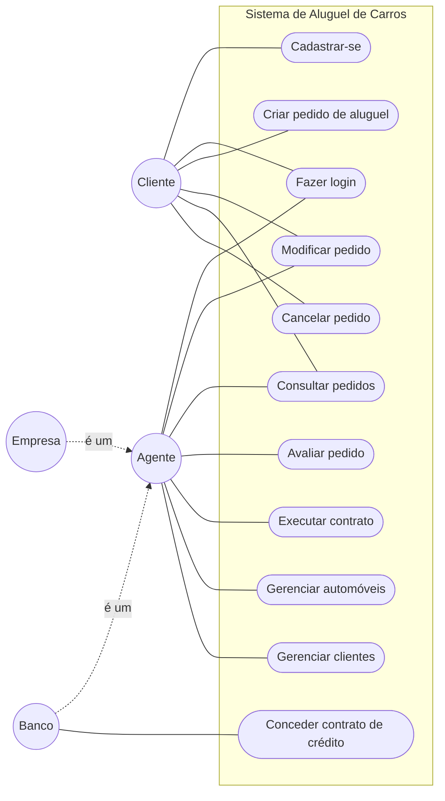

# Diagrama de Casos de Uso

## Descrição

| Caso de uso | Ator | Descrição |
|---|---|---|
| Cadastrar-se | Cliente | Cria a conta com dados pessoais, profissão e rendimentos (até 3) |
| Fazer login | Cliente, Agente | Entra no sistema com usuário e senha |
| Criar pedido de aluguel | Cliente | Escolhe um automóvel e as datas do aluguel |
| Modificar pedido | Cliente, Agente | Altera dados de um pedido que ainda não foi contratado |
| Consultar pedidos | Cliente, Agente | Cliente vê os seus pedidos, agente vê todos |
| Cancelar pedido | Cliente | Cancela um pedido que ainda não foi contratado |
| Avaliar pedido | Agente | Faz a análise financeira e dá parecer positivo ou negativo |
| Executar contrato | Agente | Transforma um pedido aprovado em contrato |
| Conceder contrato de crédito | Banco | Associa um contrato de crédito ao aluguel |
| Gerenciar automóveis | Agente | Cadastra, edita e remove automóveis |
| Gerenciar clientes | Agente | CRUD de clientes |
