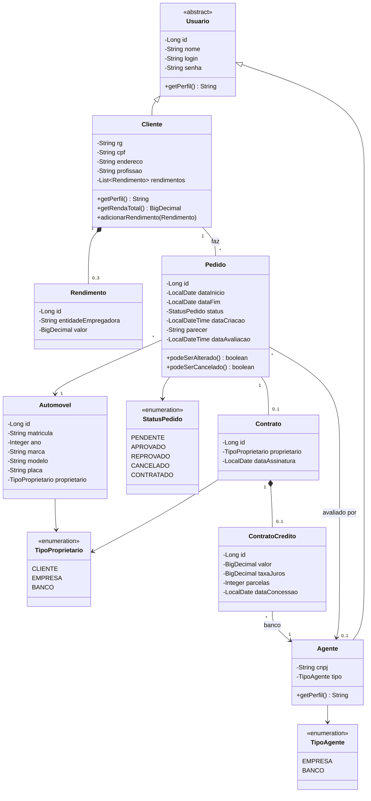

# Diagrama de Classes - v2

Versão atualizada depois da implementação. A [v1](diagrama-classes-v1.md) foi mantida para comparação.

## Mudanças em relação à v1

- `StatusPedido` ganhou o status **CONTRATADO**, para diferenciar um pedido só aprovado de um que já virou contrato.
- `Pedido` passou a guardar o **parecer** da análise financeira, o agente que avaliou e as datas de criação/avaliação.
- O proprietário do contrato deixou de ser `String` e virou o enum `TipoProprietario` (cliente, empresa ou banco). O `Automovel` também guarda quem é o proprietário depois do contrato.
- `ContratoCredito` ganhou o número de **parcelas** e a ligação com o banco que concedeu o crédito.
- Valores em dinheiro passaram de `double` para `BigDecimal`.
- `Usuario` ganhou o método abstrato `getPerfil()`, usado no login para saber se é cliente ou agente.
- `Cliente` ganhou `getRendaTotal()`, mostrado para o agente na hora da avaliação.
