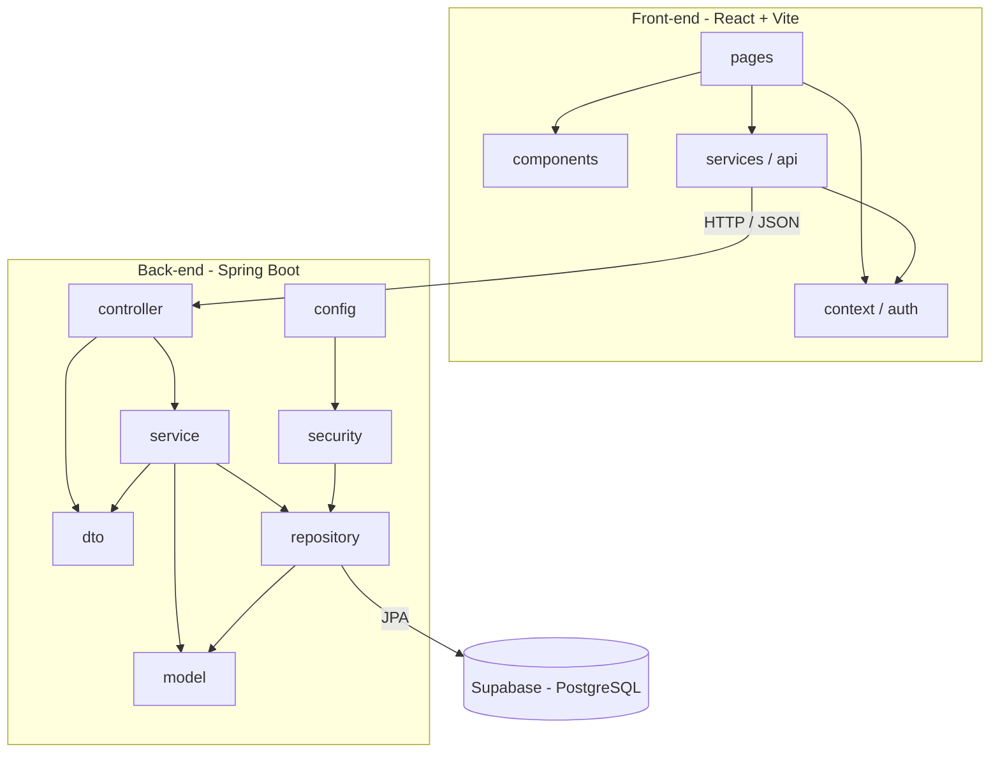

# Diagrama de Pacotes (Visão Lógica)

O sistema é dividido em dois subsistemas, como pede o enunciado: o **back-end** (gestão de pedidos e contratos, em Spring Boot com MVC) e o **front-end** (construção dinâmica das páginas web, em React).

| Pacote | Responsabilidade |
|---|---|
| model | Entidades JPA (Model do MVC) |
| repository | Acesso ao banco com Spring Data JPA |
| service | Regras de negócio |
| controller | Endpoints REST (Controller do MVC) |
| dto | Objetos de entrada e saída da API |
| security | Geração e validação do token JWT |
| config | Configuração do Spring Security e CORS |
| front-end | Páginas React (View do MVC) |
